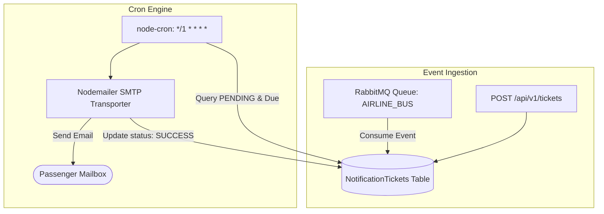

# Airline Reminder Service

## Overview
The **Airline Reminder Service** is the asynchronous communication and notification microservice of the Airline Reservation platform. It handles the scheduling, queue processing, and dispatch of email reminders (flight confirmations, boarding reminders, itinerary updates).

### Key Responsibilities:
- **Notification Persistence**: Stores reminder tickets in MySQL with target notification timestamps and statuses (`PENDING`, `SUCCESS`, `FAILED`).
- **Cron-Driven Email Dispatcher**: Executes a recurring background task every minute using `node-cron` to discover pending notifications due for delivery.
- **Nodemailer Transport**: Dispatches emails via SMTP (Gmail) and marks tickets as `SUCCESS`.
- **Message Broker Consumer**: Connects to **RabbitMQ** to consume asynchronous booking and notification events published by the **Booking Service**.

---

## Tech Stack
- **Runtime**: Node.js (v18+)
- **Framework**: Express 5
- **ORM**: Sequelize v6
- **Database**: MySQL (`mysql2` driver)
- **Email Delivery**: Nodemailer
- **Task Scheduler**: `node-cron`
- **Message Broker**: RabbitMQ via `amqplib`
- **Environment Management**: `dotenv`
- **Development Tooling**: `nodemon`, `sequelize-cli`

---

## Architecture & Job Execution Flow



---

## Environment Variables

Copy `.env.example` into `.env`:

```bash
cp .env.example .env
```

| Variable Name | Required | Default Value | Description |
| :--- | :---: | :--- | :--- |
| `PORT` | Required | `3004` | Port on which the Reminder Service listens. |
| `EMAIL_ID` | Required | `your_email@gmail.com` | Email account used as sender address for Nodemailer. |
| `EMAIL_PASSWORD` | Required | `your_gmail_app_password` | 16-character Google App Password (see instructions below). |
| `MESSAGE_BROKER_URL` | Required | `amqp://localhost:5672` | RabbitMQ connection URI. |
| `EXCHANGE_NAME` | Required | `AIRLINE_BUS` | RabbitMQ exchange name for pub/sub messaging. |
| `REMINDER_BINDING_KEY`| Required | `REMINDER_SERVICE` | RabbitMQ routing/binding key for notification events. |
| `NODE_ENV` | Optional | `development` | Runtime environment mode. |

> [!TIP]
> **Generating Gmail App Passwords**:
> 1. Go to your [Google Account](https://myaccount.google.com/).
> 2. Navigate to **Security** -> **2-Step Verification**.
> 3. Scroll to the bottom and select **App passwords**.
> 4. Create a new entry (e.g. named "Airline Service") and copy the 16-character password into `EMAIL_PASSWORD`.

### Database Configuration (`src/config/config.json`)
Sequelize database connection settings reside in `src/config/config.json`. A reference template is at `src/config/config.json.example`:

```json
{
  "development": {
    "username": "root",
    "password": "your_mysql_password",
    "database": "Reminder_DEV",
    "host": "127.0.0.1",
    "dialect": "mysql"
  }
}
```

---

## Prerequisites & Installation

### Prerequisites
1. **Node.js**: v18.0.0 or higher
2. **MySQL Server**: v8.0 or higher running on `127.0.0.1:3306`
3. **RabbitMQ Broker**: v3.9+ running on `localhost:5672`
4. Valid SMTP credentials (Gmail App Password)

### Installation Steps

1. Navigate to the reminder service folder:
   ```bash
   cd Airline_Reminder_Service
   ```

2. Install dependencies:
   ```bash
   npm install
   ```

3. Setup environment and database configurations:
   ```bash
   # Copy environment file
   copy .env.example .env

   # Configure database credentials
   copy src\config\config.json.example src\config\config.json
   ```

4. Database creation and migrations:
   ```bash
   # Create database
   npx sequelize db:create

   # Run migrations (creates NotificationTickets table)
   npx sequelize db:migrate
   ```

5. Run the service:
   ```bash
   npm start
   ```

---

## API Endpoints & Routes

### 1. Register a Notification Ticket
Creates a scheduled email ticket in the database.

- **URL**: `POST /api/v1/tickets`
- **Headers**: `Content-Type: application/json`
- **Request Body**:
  ```json
  {
    "subject": "Flight AI-101 Booking Confirmation",
    "content": "Dear Passenger, your flight from Mumbai to Delhi is confirmed. Safe travels!",
    "recepientEmail": "passenger@example.com",
    "notificationTime": "2026-10-12T16:00:00.000Z"
  }
  ```
- **Success Response** (`200 OK`):
  ```json
  {
    "success": true,
    "data": {
      "id": 1,
      "subject": "Flight AI-101 Booking Confirmation",
      "content": "Dear Passenger, your flight from Mumbai to Delhi is confirmed. Safe travels!",
      "recepientEmail": "passenger@example.com",
      "status": "PENDING",
      "notificationTime": "2026-10-12T16:00:00.000Z",
      "createdAt": "2026-10-12T15:50:00.000Z",
      "updatedAt": "2026-10-12T15:50:00.000Z"
    },
    "err": {},
    "message": "Email reminder registered successfully"
  }
  ```

---

## Scheduled Background Jobs

- **Cron Schedule**: `*/1 * * * *` (Every 60 seconds)
- **Logic**:
  1. Queries all tickets from `NotificationTickets` where `status = 'PENDING'` and `notificationTime <= NOW()`.
  2. Iterates over records and executes `nodemailer.sendMail(...)`.
  3. Upon callback success, runs `emailService.updateTicket(email.id, { status: 'SUCCESS' })`.
